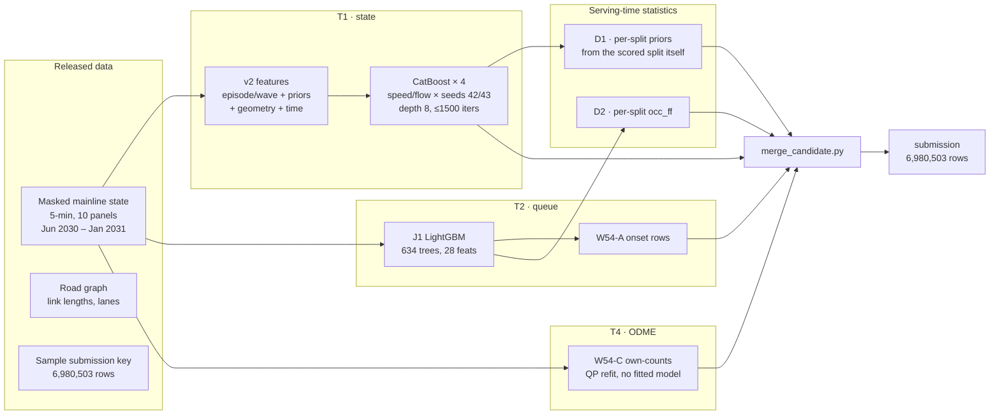

# PETU LABS — TrafficFlowBench

**Team PETU LABS · 2026 IEEE Big Data Cup: TrafficFlowBench · Kaggle `2026-ieee-big-data-traffic-flow-bench`**

Our submission to the TrafficFlowBench competition: a certified **0.85330** public-validation floor, built under one organizing principle — **optimize expected rank on the hidden private month, not the observed validation month.** Every component was gated on multi-month stability before promotion. This repo is the complete, reproducible record: the pipeline, the trained models, the two highest-scoring submissions, the architecture, and the full decision log — including every experiment we killed and why.

| | |
|---|---|
| **Public score** | **0.85330** (ref `57429904`, 20 Oct 2026) |
| **Parent** | 0.84994 (ref `57369480`, 19 Oct 2026) |
| **#1 on the board** | 0.93124 — Max Pollard (gap +0.07794) |
| **Our rank** | ~401 / 799 teams (passive drift; score unchanged) |
| **Experiments** | 253 registered; 23 board submissions |
| **Award** | Code + paper due 10 Nov 2026, 23:59 AoE |

> **Honest statement.** No credible route past 0.85330 was evidenced in our experimental program — not post-hoc, not retrain, not weight-edit. We report that plainly rather than manufacturing a seventh door. The value of this submission is not that it is the best imaginable, but that it is the best *honestly evidenced* one, and that its reproduction is proven.

## Results

| Rank | Submission | Ref | Public score | Δ vs previous |
|---|---|---|---|---|
| 1 | `submission_w57_d1d2_v1.csv` — **certified floor** | `57429904` | **0.85330** | +0.00336 |
| 2 | `submission_w54_onset_v1.csv` — floor parent | `57369480` | 0.84994 | +0.00049 |
| 3 | W54-C T4 swap | `57367435` | 0.84945 | +0.03158 (biggest single win) |
| 4 | W56-L1-TROW | `57409088` | 0.84714 | −0.00280 (rejected) |
| 5 | W28-SCALE | `57065852` | 0.81787 | +0.00257 |

Both top-2 submission files are attached to the [v1.0 release](../../releases/tag/v1.0) (GitHub's 100 MB file limit; each ~140 MB gzipped). Their md5s are in [`outputs/MANIFEST.md`](outputs/MANIFEST.md). The full 23-read ladder is in [`docs/revision.md`](docs/revision.md) §1.

## Architecture



The floor is the 0.84994 parent plus **exactly two changes** (W57 D1/D2 split-fidelity fixes), certified by audit W58-L1: D1 re-estimates the T1 priors from each scored split's own masked days; D2 re-estimates J1's `occ_ff` the same way. No train-pooled level is carried into serving anywhere. See [`docs/architecture.md`](docs/architecture.md) for the full diagrams (data flow, gate flow, class composition).

## Quickstart

```bash
git clone https://github.com/AdityaPagare619/petu-labs-trafficflowbench.git
cd petu-labs-trafficflowbench
pip install -r src/requirements.txt   # catboost==1.2.10, lightgbm==4.7.0, python 3.12

# Reproduce the floor from raw inputs (prediction-equality acceptance):
bash scripts/reproduce-final.sh
#   Stage A: rebuild the 10 training shards (10/10 md5s)
#   Stage B: retrain all four models (train_meta identical to 16 digits,
#            2000-row probe predictions bit-identical, max|Δ| = 0.0)
#   Stage C: D1/D2 fix intermediates (md5-gated)
#   Stage D: assembly re-run (md5 = e6db2a22a5e676955ab225358c0e378c)
```

The trained models ship in [`models/`](models/) (4× `.cbm` + `model_J1.txt`), so inference runs without retraining. Training data comes from the competition's released package plus the on-Kaggle dataset `adityapaagare/tfb-w28-scale` (see [`docs/data.md`](docs/data.md)). No external dataset, pretrained model, or paid API was used anywhere.

## Repository map

| Path | What it is |
|---|---|
| `outputs/MANIFEST.md` | Top-2 submissions: refs, scores, md5s, row counts, release links |
| `src/` | The pipeline: training, features, inference, merge, D1/D2 fixes, T4 solver, gates |
| `models/` | Trained models (4× CatBoost `.cbm`, J1 LightGBM text, W54-C ODME candidate) + md5 manifest |
| `data/frozen/` | Frozen D1/D2 intermediates: 20 per-split priors + per-split `occ_ff` (md5-gated) |
| `scripts/` | Reproduction (`reproduce-final.sh`), one-panel drill, Dockerfile |
| `docs/architecture.md` | System diagrams, component inventory, class composition (a)/(b)/(c) |
| `docs/competition-rules.md` | Scoring, eligibility, deadlines, award rubric, reproducibility rule |
| `docs/data.md` | Panels, months, masking census, features, training recipe |
| `docs/decision-log.md` | **The full decision log** (3,390 lines, Sep 30 – Nov 7) |
| `docs/experiment-registry.csv` | All 253 registered experiments |
| `docs/revision.md` | Principal revision: first data → floor, 10 lessons, corrections |
| `docs/award-paper.md` + `award-paper.pdf` | The award paper (draft + typeset PDF) |

## Method: the promotion contract

A candidate shipped only after passing **seven gates**: a deflated 2.67σ significance bar (calibrated to ~150 lifetime trials, so luck alone cannot promote); a hidden-box February selection month (opened once per experiment, no post-open tuning); same-sign gains on ≥3 of 5 distinct months; a bundle ablation (marginal < 0.002 dropped); an LB-vs-CV trust gate; MATH_DESIGN++ pre-registration; and a red-team review before any code. The hard gate (K3′) is: **Δ_board ≥ +0.010 composite on every month AND ΔS_physics ≥ −0.020, cross-month validated.** Panel-level evidence may kill, never promote.

The public leaderboard scores one validation month; final standings use a different hidden month. That single fact shaped the campaign: **a gain that exists only on the validation month is a liability, not an asset.**

## What we killed (and why it matters)

Six doors closed on Nov 3–4, each with a named mechanism — then the final week tested every remaining direction and closed those too:

- **C15** blend — arm correlation collapse (Δ −3.15e-07)
- **C5** J1 refit — eliminated on board evidence (−0.00139); the internal ruler, not the board, was wrong
- **RS1** 8-day retrain — population-shrink confound (identity arm −0.11266)
- **R1–R4** blind repairs — every truth-free correction direction wrong (96%-true additions deleted; lagging rows trusted; optimal shrinkage beaten)
- **C4** detector weighting — ceiling 5–10× below the bar
- **RS1R** prior swap — directional contradiction (−0.002603)
- **Synthesis sprint** — no seventh door (oracle caps: perfect information buys +0.0030)
- **Night stack** (Nov 7) — B1 + E1 + D2 + E4 stacked: mean +0.00085, ~12× below the bar; no submission made

The kill record is the paper's real contribution: it *measures* — rather than asserts — that only retraining beats the fitted surfaces, and that the floor is at a local optimum for its formulation class. Full detail in [`docs/decision-log.md`](docs/decision-log.md) and [`docs/revision.md`](docs/revision.md).

## Competition rules (summary)

`S_total = 0.35·S_state + 0.30·S_queue + 0.15·S_physics + 0.20·S_ODME`, with `S_state = 0.54·S_speed + 0.46·S_flow`. Final score = `0.85·L + 0.15·R` (R = 40 technical soundness + 40 analysis/insight + 20 clarity). Organizers rerun team code; predictions must match the private-leaderboard score within 1%. Registration closed Oct 25 (ours sent 10 Oct, amended 14 Oct, acknowledged 15 Oct — team name **PETU LABS**). Full rules in [`docs/competition-rules.md`](docs/competition-rules.md).

## License

MIT — see [LICENSE](LICENSE). The competition data itself is not redistributed; only our code, models, predictions, and record are in this repo.
