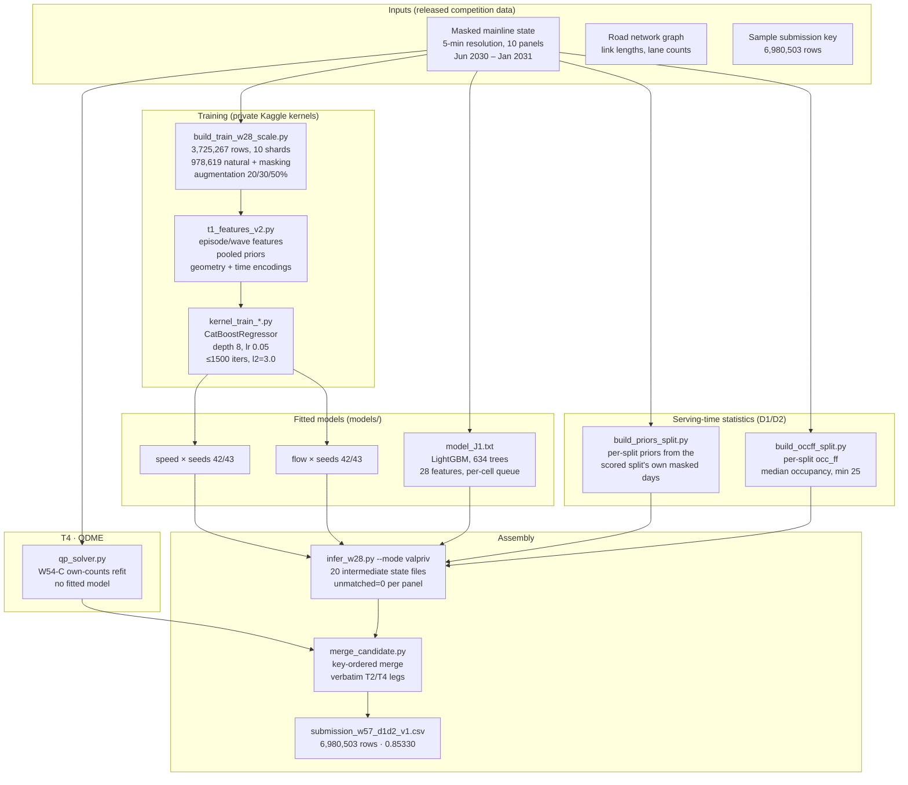
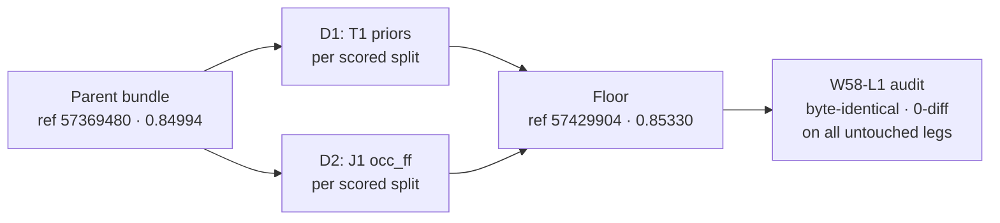

# Architecture

## System overview

## Component inventory

| Component | File(s) | Role | Size / notes |
|---|---|---|---|
| Training-data builder | `src/build_train_w28_scale.py` | 10 shards from raw masked parquets; memory-safe (one panel at a time); deterministic | 3,725,267 rows |
| Feature set v2 | `src/t1_features_v2.py` | Episode/wave, pooled priors, geometry, time encodings; frozen list `t1_feat_v2_scale.json` | — |
| Speed trainer | `src/kernel_train_speed_kmh.py` | CatBoost, private Kaggle kernel | models 16M + 19M |
| Flow trainer | `src/kernel_train_flow_vph.py` | CatBoost, private Kaggle kernel | models 7M + 7M |
| Inference driver | `src/infer_w28.py` | Recomputes v2 features; verifies all 4 models against manifest before running | 20 state files |
| Bundle assembly | `src/merge_candidate.py` | Key-ordered merge with verbatim T2/T4 legs | — |
| D1 priors | `src/build_priors_split.py`, `src/infer_d1.py` | Per-split priors; 0 fallback cells; 16,169,043 observed cells pooled | 20 npz in `data/frozen/` |
| D2 occ_ff | `src/build_occff_split.py`, `src/emit_d2.py` | Per-split occ_ff; 0 fallback links | parquets in `data/frozen/` |
| T4 solver | `src/qp_solver.py` | W54-C own-counts QP refit | candidate md5 `aa8081ea…` |
| Queue model | `models/model_J1.txt` | LightGBM text, 634 trees × 63 leaves, 28 features | 4.3 MB; md5 `92fb048c…` |
| Gates | `src/gates.py` | Seven-gate promotion checks | — |
| Verification | `src/verify_diff.py`, `src/verify_retrain.py` | Prediction-equality acceptance | — |

## The floor, by construction

Integrity proof (W58-L1 audit, 20 Oct 2026): identical row count, `submission_id`, and `task` columns vs the parent; all 70,708 ODME rows 0-diff; all onset rows 0-diff; state `queue_pred`/`path_flow` and queue `speed_kmh`/`flow_vph`/`path_flow` 0-diff; D1 moves 6,722,215 of 6,735,795 state rows (mean |Δ| 0.392 km/h speed, 10.32 vph flow); D2 flips 260 of 174,000 queue rows (41 0→1, 219 1→0). No full-leg swap — the W56 assembly error mode is excluded. D1 base run reproduces the parent (speed 3.6e-15, flow 9.1e-13); D2 base run gives 0 diffs on all 174,000 rows. Every candidate-vs-parent difference is attributable to D1 or D2 by construction.

## Class composition (a)/(b)/(c)

The floor's value is classified by *how each component transfers to a new month* — the selection criterion (class composition, not March delta):

| Class | Count | What it means |
|---|---|---|
| **(a) target-identified** | 6 | Self-calibrating: re-estimated from each scored split's own released data at serve time (T4 own counts, weak prior, measured-link set, W54-A eligibility, **D1 per-split priors, D2 per-split occ_ff**). March read +0.03158 (T4) / +0.00336 (D1+D2) = class evidence, not constants. |
| **(b) seed-invariant structure** | 17 | Priced at measured value; the floor's skeleton (W28 forms/augmentation/averaging; J1 statics+routing; 006G climatology; T3 published objects; operator A, NNLS form; assembly discipline). |
| **(c) fitted residue** | 12 | Priced at 0 under G-3 (J1 surface + thresholds; W28 surfaces + choices; W54-A surface/features/threshold/fallback/dropout; λ=0.05 with demonstrated-insensitivity bound ±0.0006). |

**Level discipline: PASS.** The bundle's only train-pooled level carriers (pooled priors, pooled occ_ff) are gone, replaced by per-split re-estimates with zero pooled fallback. Every other emitted level is pooled seed-invariant structure or priced residue.

Caveats (disclosed, not hidden): D1/D2 are *proxy-mediated* class (a) — the statistics enter through frozen decision surfaces, so no class-(a) uplift is claimed and the sign is not guaranteed. The A1 pseudo-target back-test of the exact D1/D2 procedure is not on file. D1 carries a view tilt (built from masked *view* cells, not unmasked truth frames). The W54-A onset leg does not ride into April: March priced it at ≈0 (inside the luck floor).

## The promotion gates

The hard gate K3′ (adopted 3 Nov as a uniform rule, disclosed as post-result): **Δ_board ≥ +0.010 composite on every month AND ΔS_physics ≥ −0.020, cross-month validated.** Panel-level evidence may kill, never promote.

## Why the floor stands: the ceilings

| Direction | Best measured ceiling | Gate verdict |
|---|---|---|
| Post-hoc corrections (R1–R4, C4, C15) | +0.001–0.002 | dead 5×, named mechanisms |
| T2 retrain (J1 oracle perfection) | +0.004 total | 2.4× short of the bar |
| Weight-space editing (whole-stratum perfection) | +0.00245 | 4.1× short; obstruction is diffuse (4,086 leaves for 4 cells) |
| Held items combined (E4 + E12 + E11) | ≈ +0.0013 | ~8× below |
| Night stack (B1 + E1 + D2 + E4, Nov 7) | +0.00085 mean | ~12× below; December fails on every branch |

The floor's errors are the model's conditional mean itself, spread across thousands of leaves — there is no localized obstruction to remove. A breakthrough needs a mechanism outside every family tested here; none was found.
